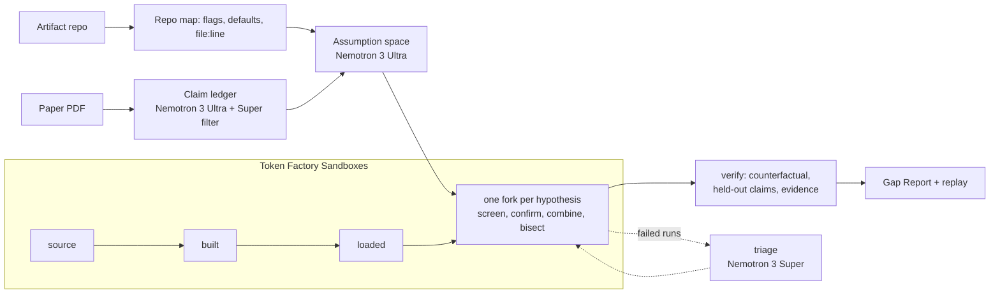

[](LICENSE)

# GapFinder

**Everyone asks whether a paper reproduces. GapFinder asks why it doesn't.**
Give it a paper PDF and the artifact's repo. It builds a claim ledger and a
ranked list of unstated experimental assumptions with Nemotron on Token
Factory. It builds and loads the artifact once in Token Factory Sandboxes,
then forks one branch per hypothesis from that exact checkpoint. The output
is a Gap Report: per-claim attributions with evidence, noise bands, and
replayable checkpoint IDs. It says "unexplained" when it should.

**Judges: open <https://sayjad21.github.io/GapFinder/> and press 16×.** It replays a recorded
RusKey run (no login, no cost). Then open **Gap Report** for the verdicts and **Scoreboard** for
GapFinder against a standard coding agent. Every number links to a log in this repo.


> Status (2026-10-09): runs end to end in Token Factory Sandboxes on a real systems paper
> (RusKey, Figure 6). GapBench-mini dev set: 4/4 with no false attributions. The held-out
> test tasks are being written by a teammate who doesn't share them with the developers.
> Plan: [docs/PLAN.md](docs/PLAN.md) · spikes: [tests/spikes/](tests/spikes/README.md).

## Results

| What | Result | Data |
|---|---|---|
| GapBench-mini dev, 4 tasks with a planted cause (or none) | **GapFinder 4/4, 0% false attribution**, median $0.04 a task. Baseline, mini-swe-agent on Nemotron 3 Super with the same environment and budget: 2/4, 50% false attribution, $0.07 a task. | [gapbench_dev_v5.json](eval/results/gapbench_dev_v5.json) |
| Claim ledger on RusKey, against a gold set signed off by the paper's reproducer | Claim precision 1.00 (40/40, measured on the paper the prompts were tuned on), headline-claim recall 1.00, all-claim recall 0.93. Setting recall 0.67, **below the 0.80 bar**: the tuner's mode flags are missed. | [ledger_ruskey_v5.json](eval/results/ledger_ruskey_v5.json) |
| RusKey Figure 6, end to end in Sandboxes | 127 branches from 13 database loads: nothing explains the balanced-workload claims at 2M keys (**Unexplained**). Counting load-to-load noise (next row), K1/K5 is within noise of the paper and K10/K5 is 31% short. | [FINDINGS.md](papers/ruskey/FINDINGS.md) |
| Setup reproducibility check | 5 loads with the identical command gave **5 different checkpoints**. Across 12 loads the naive K1/K5 ratio ranged from 0.52 to 1.38. GapFinder now widens its noise band to cover this. It also corrected two observations from the 127-branch run, which had drawn an outlier load. | [search_setups](papers/ruskey/search_setups/gap_report.md), [load_variance.json](eval/results/ruskey_load_variance.json) |
| Fork vs no-fork, same search, 22 branches each | Forking: 8 database loads instead of 22, setup cost $1.88 instead of $5.21 (-64%), total $4.48 instead of $8.07 (-45%). | [ablation_ruskey.json](eval/results/ablation_ruskey.json) |

## How it works



1. **Claim ledger** (Nemotron 3 Ultra, then a Super filter). Every result the paper claims (numbers,
   comparisons, trends), with a quote that must string-match the PDF. Quotes that don't match are dropped, not repaired.
2. **Assumption space** (Ultra). Settings the result could depend on, each tied to a quote from the
   paper or a `file:line` in the repo (checked), with the paper's stated value if there is one.
3. **Checkpoint tree** (Sandboxes). Build once, load once, then fork every hypothesis from the
   deepest checkpoint still valid for it: a config change forks the loaded database, a dataset
   change reloads from the build, a build flag rebuilds.
4. **Search.** Screen one change per branch, confirm survivors with repeats, combine the best,
   bisect combinations to a minimal set, then verify: revert each knob (the gap must come back),
   check held-out claims (they must not get worse beyond noise), and look for evidence that the
   authors actually used the value (paper, code, then the web).
5. **Labels:** Explained, Paper-artifact inconsistency, Partially explained, Fits but unsupported,
   Unexplained. A value that closes the gap but has no evidence is "Fits but unsupported", never
   "Explained". When the budget runs out, nothing is labelled from runs that weren't confirmed.

## How we use Nemotron on Token Factory

| Tier | Job in GapFinder | Calls | Tokens in / out | Billed |
|---|---|---|---|---|
| Nemotron 3 Ultra | Claim extraction and the assumption space (the two long-context reasoning calls per paper) | 20 | 757K / 205K | $1.37 |
| Nemotron 3 Super | Result filter on extracted claims; triage of failed branches (reads the error, proposes a valid value) | 4 | 4K / 7K | $0.007 |
| Nemotron 3 Super | The baseline agent (mini-swe-agent) on GapBench | 128 | 1.19M / 31K | $0.39 |
| Nemotron 3 Nano | Fallback metric parser for unknown log formats, every value grounded in the log | 2 | 360 / 411 | <$0.001 |

All billed inference to date, development included, is **$1.92**; that includes a +$0.16
reconciliation against the console. Every call goes through one router
([router.py](gapfinder/models/router.py)) with these safeguards:
- It splits the reasoning trace from the answer and recovers once from an empty answer.
- It repairs malformed JSON.
- It checks a hard spend cap before each call and records the cost after.
- It caches every response, so re-running any experiment or the dev set is free.

Nano was exercised only in a spike: every artifact here prints a format the deterministic parsers
already handle.

## How we use Token Factory Sandboxes

- **One loaded database, many forks.** RusKey's 2M-key database takes about 24 s and $0.24 to
  load. The full Figure 6 search ran 127 branches from 13 loads ($3.08 of setup). Without forking,
  each branch would reload: about 127 loads, $30 of setup and $48 in total instead of $21.
- **Content-addressed checkpoints as a measurement.** Identical filesystems get identical IDs
  (spike S2). GapFinder uses this to check whether the setup itself is reproducible. With
  `--noise-setups N`, it loads the database N times with the same command before trusting a noise
  band. If the IDs differ, the band includes load-to-load variation, which forked runs alone would
  never show.
- **Replayable answers.** Every attribution in a Gap Report names the checkpoint it forked from
  and the exact command; the UI replays recorded runs at no cost.
- **Spend guards on our side.** Each command runs under `ulimit -t`, and a guard on the
  reported sandbox cost refuses new runs past a set limit. Sandboxes are unbilled in Beta; the
  reported cost is still tracked: $48.67 in total, $47.27 of it on RusKey.
- **No code edits.** A diff guard rejects any branch that touches files outside the spec's
  allowed paths, so GapFinder can only change conditions, never the algorithm.

## Honest limitations

- CPU only: Sandboxes VMs have 4 vCPUs and 3.9 GB, so GPU papers and the paper's full data scale
  are out of reach.
- The harness spec (how to build, load and run the artifact, and which knobs exist) is drafted
  from the repo map but needs a human to confirm it.
- Timing metrics are noisy in shared VMs. GapFinder compares ratios measured inside one VM, uses
  noise bands from repeats, and confirms with more repeats when a metric's CV is above 5%.
- The dev set has 4 tasks, built by the same people who built GapFinder. The test set is the
  real measure, and isn't run yet.
- Ledger precision was measured on the paper the prompts were developed on.
- RusKey ran at 2M keys; the paper used 100M. Settings that only matter at scale can't be
  tested here, and the report lists them as untestable.
- RusKey's database load is not reproducible: the same command gives a different database
  layout each time, and the Figure 6 ratios depend on it. Conclusions drawn from one load
  don't carry over (see [FINDINGS.md](papers/ruskey/FINDINGS.md)).

## Quick start (no credentials needed)

Teammates: see [SETUP.md](SETUP.md) for the full setup, keys and budget rules.

```bash
uv venv --python 3.11 .venv && uv pip install --python .venv -e ".[dev,baseline]"
.venv/bin/pytest                                  # unit + local-backend integration tests
.venv/bin/gapfinder fanout --spec eval/toy/hidden_knob.yaml --knobs eval/toy/knobs.json --backend local
.venv/bin/gapfinder repomap path/to/any/repo
```

With credentials in `.env` (see `.env.example`):

```bash
gapfinder ledger papers/ruskey/ruskey_paper.pdf --repo <path-or-url>
gapfinder search --spec <paper>.yaml --targets targets.json --assumptions assumptions.json \
    --claims claim_ledger.json --backend contree --noise-setups 5
```

## Web UI (replay mode)

```bash
npm --prefix web ci && npm --prefix web run build      # once
.venv/bin/uvicorn gapfinder.api.server:app --port 8000  # then open http://localhost:8000
```

It lands on **Replay**, which plays a recorded run (from `demo/runs/`) at 1x, 4x or 16x and costs
nothing. The other tabs are the **Gap Report** cards (with replay commands) and the **Scoreboard**
(GapBench arms, per-task answers). Live mode stays off and refuses politely until an access code
is configured. Browser test: `pytest -m e2e tests/e2e` (it checks both sites below).

The public site is a static build of the same UI, made by
[pages.yml](.github/workflows/pages.yml) on every push: `scripts/export_static.py` writes what the
API would serve, and the browser replays the events itself, with no server and no keys.

## Scope rule

GapFinder changes only experimental conditions: configs, flags, workload,
build options and environment. It never edits the paper's algorithm code. A
diff guard enforces this.

## Provenance

GapFinder is being built during the hackathon submission period. The RusKey
reproduction it's tested on is Sayjad Rahman's earlier research, used here as
a test case.
