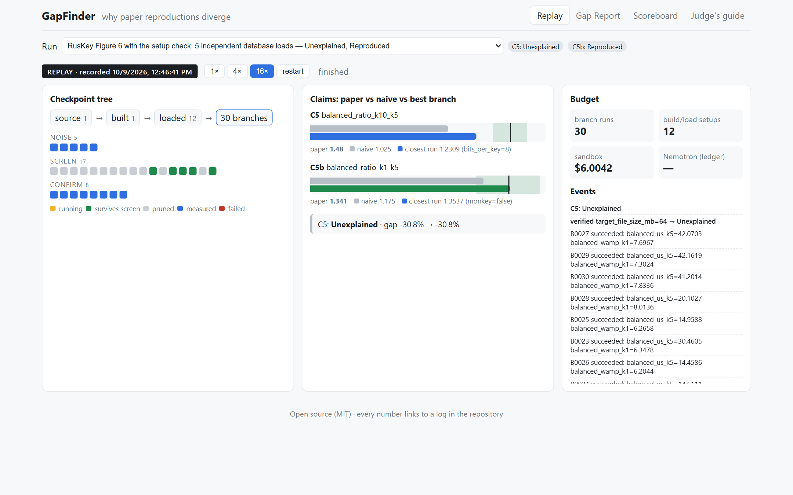
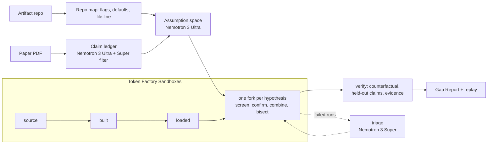

[](LICENSE)

# GapFinder

**Everyone asks whether a paper reproduces. GapFinder asks why it doesn't.**
Give it a paper PDF and the artifact's repo. It builds a claim ledger and a
ranked list of unstated experimental assumptions with Nemotron on Token
Factory. It builds and loads the artifact once in Token Factory Sandboxes,
then forks one branch per hypothesis from that exact checkpoint. The output
is a Gap Report: per-claim attributions with evidence, noise bands, and
replayable checkpoint IDs. It says "unexplained" when it should.

**Judges: open <https://sayjad21.github.io/GapFinder/> and press 16×.** It replays a recorded
RusKey run (no login, no cost). Then open **Gap Report** for the verdicts and **Scoreboard** for
GapFinder against a standard coding agent. Every number links to a log in this repo.

**New to the project?** [docs/learn/](docs/learn/README.md) explains it from the start in plain words:
what it is, how to use it, the architecture, each component, the design choices and how it got here.



> Status (2026-10-17): **v1.4**.
> - **Blind sealed tests** (GapBench, a fresh generated set for each version, seed made after the
>   version tag): GapFinder was **confidently wrong in 0 of 90 runs** across v1.1-v1.3, against 8-22 of
>   30 per test for a standard coding agent. It named the planted cause in 7, 12 and 9 of 15 runs. The
>   misses are interactions where several settings fit the paper's numbers equally well.
> - **On a real paper (MC Dropout, not blind):** v1.3 names the documented cause (`epochx=10,
>   hidden=1`), says the rest is outside the settings, and points to the right lines of code.
> - **Blind real papers (sealed by a separate model), 0 of 2 correct:**
>   - **FastGCN (v1.3): missed, not confidently wrong.** It named the right setting (`learning_rate`)
>     but the wrong value, labelled only "fits but unsupported"
>     ([RESULT.md](eval/external/blind-1/RESULT.md)).
>   - **GraphMAE (v1.4): confidently wrong.** It said "Explained: `mask_rate=0.5`"; the documented cause
>     is `alpha_l=1`. The ledger never saw the appendix table that states it, so GapFinder skipped the
>     true setting, and an equally good fit passed on weak code evidence
>     ([RESULT.md](eval/external/blind-2/RESULT.md)).
>   - This is GapFinder's first confident mistake on a blind test.
> - **New:** it tests hard-coded constants in memory ("patch knobs") without editing a file.
>
> Plan: [docs/PLAN.md](docs/PLAN.md) · full context: [docs/CONTEXT_v11.md](docs/CONTEXT_v11.md) ·
> spikes: [tests/spikes/](tests/spikes/README.md).

## Results

**Latest (v1.1-v1.3).** Each version was frozen with a git tag before a new sealed set was generated from
a seed made after the tag. 10 tasks × 3 runs per arm; the pre-registration is in
[PROTOCOL.md](eval/gapbench/PROTOCOL.md).

| Sealed test | GapFinder: confidently wrong (exact 95% CI) | Correct causes (of 15) | Correct abstentions (of 15) | Balanced accuracy | Out-of-space diagnosed | Coding-agent baseline: confidently wrong |
|---|---|---|---|---|---|---|
| [v1.1](eval/results/gapbench_test_v11.md) | **0/30** (0-12%) | 7 (+1 partial) | 15 | 0.73 | 0/9 | 19/30 |
| [v1.2](eval/results/gapbench_test_v12.md) | **0/30** (0-12%) | 12 | 15 | 0.90 | 4/9 | 8/30 |
| [v1.3](eval/results/gapbench_test_v13.md) | **0/30** (0-12%) | 9 (+1 partial) | 15 | 0.80 | 6/9 | 22/30 |

How to read the table:
- Always answering "Unexplained" would score balanced accuracy 0.50.
- **v1.3 missed two of its four pre-registered criteria** (correct causes ≥ 12, balanced accuracy
  ≥ 0.85). Every v1.3 miss is on its two interaction tasks, where several settings fit the paper's
  numbers equally well.
- The sets differ, so v1.1 → v1.3 is not a paired comparison.
- On the public dev tasks, a paired per-task comparison of v1.1 against the phase-3 code (22 tasks, two
  replicates each, `eval/compare_suites.py`) found 5 tasks better and 3 worse (sign test p = 0.73): no
  significant change per task. What holds up is safety.

| Real paper, blind | Result | Data |
|---|---|---|
| GraphMAE (Hou et al., KDD 2022), Table 2 COLLAB (80.32), with IMDB-B, IMDB-M and MUTAG held out (tuned separately). Frozen at `v1.4` = `blind-2`, sealed by a separate model. 59 local Docker runs: COLLAB is OOM-killed on a 4 GB Sandboxes VM. | **Confidently wrong:** "Explained: `mask_rate=0.5`" (gap -2.2% → -0.1%). The documented cause is `alpha_l=1` (the authors, issue #16). The ledger's prompt stopped before appendix Table 8, which states γ = 1 for COLLAB. It then recorded the code's `alpha_l` default as the paper's value, and the search dropped `alpha_l` as "stated and already matching" before a single run. `mask_rate=0.5` fits as well, but its evidence was the code's default, which COLLAB's config overrides. | [RESULT.md](eval/external/blind-2/RESULT.md), [PRE_REVEAL.md](eval/external/blind-2/PRE_REVEAL.md) |
| FastGCN (Chen et al., ICLR 2018), Table 5 transductive Cora (0.818), 3 held-out rows. GapFinder was frozen at tag `blind-1`. A separate model (Claude Sonnet) chose the paper and sealed the answer key, and its hash was committed before any run. 45 Sandboxes runs. | **Missed under the pre-registered rule, not confidently wrong.** "Fits but unsupported: `learning_rate=0.005`" (gap -2.3% → -1.1%). The documented cause is learning rate 0.001 (the repo owner, issue #10). GapFinder tested 0.001 and it matched the target (0.817), but the harness shares one learning rate across all four rows, and the inductive Cora row dropped to 0.641 against 0.723, so the held-out check rejected it. A blind-found gap: the repo map doesn't read `tf.app.flags`, so only `learning_rate` was screened. Post-hoc (not counted), with only the transductive row held out, the same runs give **Explained, `learning_rate=0.001`**. | [RESULT.md](eval/external/blind-1/RESULT.md), [PRE_REVEAL.md](eval/external/blind-1/PRE_REVEAL.md) |

| Real paper (not blind) | Result | Data |
|---|---|---|
| MC Dropout (Gal & Ghahramani, ICML 2016) on v1.3, 244 Sandboxes runs | **Names the documented cause** (`epochx=10, hidden=1`, confirmed) and labels it "explains the target, conflicts with the held-out claim". History matching: **out of space suspected**. Static code leads name the documented out-of-flag differences (per-split grid search, `batch_size = 128`, `T = 10000`). A **patch round** tested three hard-coded constants in memory on the real sandbox: only the training batch size moves held-out Yacht (pair + 64: Yacht 1.18 vs the paper's 1.11), and no patch fits both claims within noise, so none was adopted. v1.0 had said "Unexplained" and never tried the documented values. | [RESULT_v13.md](eval/external/mc-dropout/RESULT_v13.md) |

**Earlier results (v1.0):**

| What | Result | Data |
|---|---|---|
| **GapBench-mini blind test, run twice:** 8 tasks drawn by a sealed generator from a seed created after the freeze, 3 runs per task per arm. Run 1 on the code at the first test, run 2 on the frozen tag `v1.0` (same arms, caps and `--fresh`). | **GapFinder: 0 of 24 runs confidently wrong in both runs** (95% CI 0-14%), and 9 of 9 correct abstentions on the no-cause tasks both times. It named the right cause in 5 of 15 runs (run 1) and 7 of 15 (run 2), and solved 4 of 8 tasks (run 1, CI 22-79%) and 6 of 8 (run 2, CI 41-93%) in the median run. Its answers were stable across the 3 runs of a task (0.83 and 0.88; 1.0 is identical every time). Baseline (mini-swe-agent + Super): confidently wrong in 14 of 24 runs (58%) and 12 of 24 (50%), 1 and 2 of 8 tasks solved, stability 0.46 and 0.58. Without verification: 7 of 24 confidently wrong in both runs (29%). **Ablation finding:** random hypothesis order and evidence-off found as many or more causes than the full pipeline in both runs (random: 9 of 15 both times, 6 and 7 of 8 tasks; evidence-off: 8 of 15 both times, 6 of 8 tasks), with none confidently wrong, so on these tasks the ledger ranking and the evidence gate cost recall rather than help it. The full pipeline never fully solved an interaction task (0 of 12 runs across both runs, 2 partial). The search code did not change between the runs, so 5 to 7 of 15 is run-to-run variation, not an improvement. 8 tasks on toy artifacts is a small sample, the 3 runs of a task are not independent, and the intervals overlap, so this is not a conclusive win. One run 2 `gapfinder-random` run crashed (a truncated model answer) and is scored missed, as the protocol says. | [gapbench_test_v1.json](eval/results/gapbench_test_v1.json) (run 1), [gapbench_test_v2.json](eval/results/gapbench_test_v2.json) (run 2), [PROTOCOL.md](eval/gapbench/PROTOCOL.md) |
| GapBench-mini dev, 4 tasks with a planted cause (or none) | **GapFinder 4/4, 0% false attribution**, median $0.04 a task. Baseline, mini-swe-agent on Nemotron 3 Super with the same environment and budget: 2/4, 50% false attribution, $0.07 a task. | [gapbench_dev_v5.json](eval/results/gapbench_dev_v5.json) |
| Claim ledger on RusKey, against a gold set signed off by the paper's reproducer | Claim precision 1.00 (40/40, measured on the paper the prompts were tuned on), headline-claim recall 1.00, all-claim recall 0.93. Setting recall 0.67, **below the 0.80 bar**: the tuner's mode flags are missed. | [ledger_ruskey_v5.json](eval/results/ledger_ruskey_v5.json) |
| RusKey Figure 6, end to end in Sandboxes | 127 branches from 13 database loads: nothing explains the balanced-workload claims at 2M keys (**Unexplained**). Counting load-to-load noise (next row), K1/K5 is within noise of the paper and K10/K5 is 31% short. | [FINDINGS.md](papers/ruskey/FINDINGS.md) |
| Setup reproducibility check | 5 loads with the identical command gave **5 different checkpoints**. Across 12 loads the naive K1/K5 ratio ranged from 0.52 to 1.38. GapFinder now widens its noise band to cover this. It also corrected two observations from the 127-branch run, which had drawn an outlier load. | [search_setups](papers/ruskey/search_setups/gap_report.md), [load_variance.json](eval/results/ruskey_load_variance.json) |
| Fork vs no-fork, same search, 22 branches each | Forking: 8 database loads instead of 22, setup cost $1.88 instead of $5.21 (-64%), total $4.48 instead of $8.07 (-45%). | [ablation_ruskey.json](eval/results/ablation_ruskey.json) |
| MC Dropout (Gal and Ghahramani, ICML 2016), external case with a documented cause, semi-blind | **All 4 arms Unexplained** (normal, evidence off, no README, all flags random): no false attribution, but none found the cause, so no credit under the pre-registered key. The documented setting (`epochx=10 hidden=1`, both needed) does close the Energy gap when re-run (median 1.72 against the paper's 1.66, defaults 0.36), so the cause was findable and the search missed it: no candidate value was near `epochx=10`. The same setting overshoots held-out Yacht (3.00 against 1.11), so the held-out check would most likely have rejected it anyway. Caveats: semi-blind, 3-split scaled reproduction, arms split across local Docker and Sandboxes. | [RESULT.md](eval/external/mc-dropout/RESULT.md) |

GapBench-mini blind test, per arm, run 1 / run 2 on `v1.0` (counts of runs; each arm has 24 runs, 15 on tasks with a cause and 9 on tasks with none; solved is tasks out of 8 in the median run, with a 95% Wilson interval over tasks). Sources: [run 1](eval/results/gapbench_test_v1.json), [run 2](eval/results/gapbench_test_v2.json).

| Arm | Confidently wrong (of 24) | Correct abstentions (of 9) | Correct cause (of 15) | Solved, median run (of 8) | Answer stability |
|---|---|---|---|---|---|
| gapfinder | 0 / 0 | 9 / 9 | 5 / 7 | 4 (22-79%) / 6 (41-93%) | 0.83 / 0.88 |
| baseline-super | 14 / 12 | 1 / 2 | 4 / 4 | 1 (2-47%) / 2 (7-59%) | 0.46 / 0.58 |
| gapfinder-noverify | 7 / 7 | 6 / 6 | 7 / 9 | 5 (31-86%) / 5 (31-86%) | 0.75 / 0.83 |
| gapfinder-random | 0 / 0 | 9 / 8 | 9 / 9 | 6 (41-93%) / 7 (53-98%) | 0.83 / 0.75 |
| gapfinder-noevidence | 0 / 0 | 9 / 9 | 8 / 8 | 6 (41-93%) / 6 (41-93%) | 0.71 / 0.83 |

Partly correct causes (not in "correct cause"): gapfinder 2 / 0, baseline-super 1 / 1, noverify 0 / 1, random 1 / 1, noevidence 1 / 1.

## How it works



1. **Claim ledger** (Nemotron 3 Ultra, then a Super filter). Every result the paper claims (numbers,
   comparisons, trends), with a quote that must string-match the PDF. Quotes that don't match are dropped, not repaired.
2. **Assumption space** (Ultra). Settings the result could depend on, each tied to a quote from the
   paper or a `file:line` in the repo (checked), with the paper's stated value if there is one.
3. **Checkpoint tree** (Sandboxes). Build once, load once, then fork every hypothesis from the
   deepest checkpoint still valid for it: a config change forks the loaded database, a dataset
   change reloads from the build, a build flag rebuilds.
4. **Search.** Screen one change per branch, confirm survivors with repeats, combine the best,
   bisect combinations to a minimal set, then verify: revert each knob (the gap must come back),
   check held-out claims (they must not get worse beyond noise), and look for evidence that the
   authors actually used the value (paper, code, then the web).
5. **Labels:** Explained, Paper-artifact inconsistency, Partially explained, Fits but unsupported,
   Unexplained. A value that closes the gap but has no evidence is "Fits but unsupported", never
   "Explained". When the budget runs out, nothing is labelled from runs that weren't confirmed.

## How we use Nemotron on Token Factory

Grouped from [spend_ledger.jsonl](eval/results/spend_ledger.jsonl) by tier and spend tag. "Dev" is
everything before the test runs and the external case (RusKey, GapBench dev, spikes).

| Tier | Job in GapFinder | Calls | Tokens in / out | Billed |
|---|---|---|---|---|
| Nemotron 3 Ultra | Claim extraction and the assumption space (the two long-context reasoning calls per paper). Dev and RusKey | 20 | 757K / 205K | $1.37 |
| Nemotron 3 Ultra | The same two calls for the MC Dropout case (two ledgers) | 4 | 67K / 67K | $0.27 |
| Nemotron 3 Ultra | The same two calls (about two per GapFinder run, `--fresh`) in the four GapFinder arms of GapBench test run 1 | 200 | 565K / 1.70M | $5.67 |
| Nemotron 3 Ultra | Test run 2 on `v1.0`, same arms (includes the first, failed launch) | 203 | 588K / 1.64M | $5.52 |
| Nemotron 3 Super | Result filter on extracted claims; triage of failed branches (reads the error, proposes a valid value). All phases | 13 | 14K / 19K | $0.02 |
| Nemotron 3 Super | The baseline agent (mini-swe-agent) on GapBench dev | 128 | 1.19M / 31K | $0.39 |
| Nemotron 3 Super | The baseline agent, test run 1 | 592 | 5.54M / 173K | $1.82 |
| Nemotron 3 Super | The baseline agent, test run 2 | 613 | 5.99M / 172K | $1.95 |
| Nemotron 3 Nano | Fallback metric parser for unknown log formats, every value grounded in the log | 2 | 360 / 411 | <$0.001 |

All billed inference to date, development, both test runs and the MC Dropout case included, is
**$17.17** (1,775 model calls). That is $17.01 of calls plus $0.16 reconciled against the console on
2026-10-08 and $0.004 for two calls that failed after being sent. Nearly all of it is the two long
Ultra calls per GapFinder run and the Super baseline's steps. Every call goes through one router
([router.py](gapfinder/models/router.py)) with these safeguards:
- It splits the reasoning trace from the answer and recovers once from an empty answer.
- It repairs malformed JSON.
- It checks a hard spend cap before each call and records the cost after.
- It caches every response, so re-running any experiment or the dev set is free.

Nano was exercised only in a spike: every artifact here prints a format the deterministic parsers
already handle.

## How we use Token Factory Sandboxes

- **One loaded database, many forks.** RusKey's 2M-key database takes about 24 s and $0.24 to
  load. The full Figure 6 search ran 127 branches from 13 loads ($3.08 of setup). Without forking,
  each branch would reload: about 127 loads, $30 of setup and $48 in total instead of $21.
- **Content-addressed checkpoints as a measurement.** Identical filesystems get identical IDs
  (spike S2). GapFinder uses this to check whether the setup itself is reproducible. With
  `--noise-setups N`, it loads the database N times with the same command before trusting a noise
  band. If the IDs differ, the band includes load-to-load variation, which forked runs alone would
  never show.
- **Replayable answers.** Every attribution in a Gap Report names the checkpoint it forked from
  and the exact command; the UI replays recorded runs at no cost.
- **Spend guards on our side.** Each command runs under `ulimit -t`, and a guard on the
  reported sandbox cost refuses new runs past a set limit. The `cost` field the Sandboxes API
  reports is a diagnostic figure: the billing console did not charge for it during the Beta, and
  neither does our billed total above. We still track it in
  [spend_ledger.jsonl](eval/results/spend_ledger.jsonl): $2,665.07 reported in total, of which
  $47.27 is RusKey (127-branch search, setup checks, fork ablation), $2,615.79 is MC Dropout
  (4 arms, confirmation runs, post-hoc diagnostic) and $2.00 is spikes and probes. The MC Dropout
  figure is large because those cells ran for many CPU-hours, and the reported time is CPU time
  summed over processes ([FEEDBACK.md](FEEDBACK.md), items 10, 13 and 14).
- **No code edits.** A diff guard rejects any branch that touches files outside the spec's
  allowed paths, so GapFinder can only change conditions, never the algorithm.

## Honest limitations

- Small samples.
  - Each sealed test has 15 cause runs over 5 tasks.
  - The dev suite has 23 cause tasks, and its replicates of identical code differ by about ±5 runs.
  - Accuracy changes between versions are within that noise. The synthetic safety result (0 confidently
    wrong in 90 blind runs) is the robust one.
- **Two blind real papers, both sealed by a separate AI model, not a person. Neither was correct.**
  - FastGCN: missed.
  - GraphMAE: **confidently wrong**.
  - So the synthetic safety result does not carry over to real papers yet. MC Dropout was not blind: its
    answer key was revealed before v1.1. Protocol: [BLIND_CASE.md](eval/external/BLIND_CASE.md).
- **Fixed after blind-1, tested on blind-2:**
  - the repo map didn't read `tf.app.flags` / absl;
  - spec knobs no assumption named were never screened;
  - guessed code defaults weren't checked;
  - rows tuned separately acted as vetoes.

  These worked as designed on GraphMAE, but the miss came from elsewhere.
- **Open after blind-2** ([RESULT.md](eval/external/blind-2/RESULT.md)):
  - the assumption step sees only the first 25,000 characters of the paper, so appendix hyperparameter
    tables are missed;
  - a "stated" paper value isn't required to appear in a paper quote;
  - a knob whose stated value matches the naive run is dropped, not ranked last;
  - a code default that the dataset's config overrides counts as evidence.
- Patch knobs test literals in Python modules only. A loop, a grid search or a data pipeline can't be
  patched this way.
- CPU only: Sandboxes VMs have 4 vCPUs and 3.9 GB, so GPU papers and the paper's full data scale
  are out of reach.
- The harness spec (how to build, load and run the artifact, and which knobs exist) still needs a
  person to read and approve it. `gapfinder spec-draft` drafted a spec that built, ran and passed
  its smoke test on both GapBench artifacts we tried (2 attempts each, $0.0081 in total), found
  all 27 hand-written knobs with matching defaults, and ran unedited. The human input left is
  approval, not writing. We did not try it on MC Dropout (large Docker repo), and the two
  artifacts are small single-script repos, so expect more edits on real research code
  ([results](eval/results/spec_draft_live.md)).
- Timing metrics are noisy in shared VMs. GapFinder compares ratios measured inside one VM, uses
  noise bands from repeats, and confirms with more repeats when a metric's CV is above 5%.
- The dev set has 4 tasks, built by the same people who built GapFinder. The test set is the
  real measure: 8 generator tasks, run twice, with the answers now published. It is small, and
  on it GapFinder's ledger ranking and evidence step did not raise recall (see Results). Tasks from
  an independent AI author are not written yet, so there is no result from them.
- GapBench's harder categories (interacting settings, decoys, no supported cause) land mostly on
  the ML artifact, because the RL artifact's noise is too wide to build those tasks on. The RL
  tasks mostly cover the simple categories.
- RL verdicts can flip between runs by design: each run uses its own seeds. That is why the test
  protocol scores 3 runs per task and reports answer stability, not only the best run.
- Ledger precision was measured on the paper the prompts were developed on.
- RusKey ran at 2M keys; the paper used 100M. Settings that only matter at scale can't be
  tested here, and the report lists them as untestable.
- RusKey's database load is not reproducible: the same command gives a different database
  layout each time, and the Figure 6 ratios depend on it. Conclusions drawn from one load
  don't carry over (see [FINDINGS.md](papers/ruskey/FINDINGS.md)).

## Quick start (no keys, free)

```bash
uv venv --python 3.11 .venv && uv pip install --python .venv -e ".[dev,baseline]"   # once, see SETUP.md
python scripts/try_it.py                      # dev-ml-threshold, about 20 s
python scripts/try_it.py --task dev-rl-schedule
python scripts/try_it.py --list               # the four GapBench dev tasks
```

This runs a full GapFinder investigation on a GapBench dev task: the claim ledger, the assumption
space, the search (screen, confirm, combine, bisect, verify) and the Gap Report, which it prints
and saves to `runs/try_it/<task>/gap_report.md`. It needs no `.env`, no API key and no network.
The Nemotron answers are the recorded ones in [demo/cache/](demo/cache/) (9 responses, 185 KB,
model output only). The experiments themselves run for real on your machine with the local
backend, so you need the install from [SETUP.md](SETUP.md) and, on Windows, Git for Windows.
The script opens the cache read-only (`GF_CACHE_ONLY=1`): a call that isn't recorded stops the
run instead of reaching an API, so it can't spend anything.

Timed on the development machine (Windows 11, local backend, models replayed from the cache):
dev-ml-threshold 16 s, dev-ml-normalize 13 s, dev-rl-schedule 22 s, dev-rl-nocause 41 s. We
haven't timed a fresh clone on another machine yet; the plan's bar is under 15 minutes including
the install. The two RL tasks train a small agent with per-run seeds, so their numbers vary a
little from run to run, and the verdict on `dev-rl-schedule` can flip between "Paper-artifact
inconsistency" and "Unexplained" (the committed run in [eval/gapbench/runs/](eval/gapbench/runs/)
is one draw).

For development and tests (also free; SETUP.md has the Windows notes):

```bash
.venv/bin/pytest                                  # unit + local-backend integration tests
.venv/bin/gapfinder fanout --spec eval/toy/hidden_knob.yaml --knobs eval/toy/knobs.json --backend local
.venv/bin/gapfinder repomap path/to/any/repo
```

## With credentials

Put the keys in `.env` (see `.env.example` and SETUP.md for the budget rules). Then:

```bash
gapfinder ledger papers/ruskey/ruskey_paper.pdf --repo <path-or-url>
gapfinder search --spec <paper>.yaml --targets targets.json --assumptions assumptions.json \
    --claims claim_ledger.json --backend contree --noise-setups 5
gapfinder spec-draft <repo> --out draft.yaml      # draft a harness spec and smoke-test it
```

A few `search` flags, all optional:
- `--rank random --seed N`: the random-search arm. It tries the hypotheses in shuffled order, with
  no ledger ranking, to test whether the ranking helps.
- `--no-evidence-gate`: an ablation that skips the evidence step. A value that closes the gap is
  then at most "Fits but unsupported".
- `--missing-sentence` (also the `missing-sentence` subcommand): after a finished run, drafts the
  methods sentence the paper was missing for confirmed causes, plus a polite issue draft. It's a
  file only, never posted, costs a few Super calls and is off by default.
- `--reproduce-tol`: a claim is called Reproduced only if its noise band is within this fraction
  of the paper value (default 10%); otherwise it is Inconclusive.

## Why the quick start runs locally

**Option B** (TODO P1-4: A is replay only, B runs locally from cached answers, C is hosted
live mode). A already exists and can't let anyone start anything. C needs paid hosting, an access
code and a kill switch, and would put the $50 credit at risk. B lets a judge run the actual
pipeline on a task in seconds, costs nothing, and shows the same search and verdicts the replay
does. The cost is that it covers only the four dev tasks: running a new paper still needs keys.

## Web UI (replay mode)

```bash
npm --prefix web ci && npm --prefix web run build      # once
.venv/bin/uvicorn gapfinder.api.server:app --port 8000  # then open http://localhost:8000
```

It lands on **Replay**, which plays a recorded run (from `demo/runs/`) at 1x, 4x or 16x and costs
nothing. The other tabs are the **Gap Report** cards (with replay commands) and the **Scoreboard**
(GapBench arms, per-task answers). Live mode stays off and refuses politely until an access code
is configured. Browser test: `pytest -m e2e tests/e2e` (it checks both sites below).

The public site is a static build of the same UI, made by
[pages.yml](.github/workflows/pages.yml) on every push: `scripts/export_static.py` writes what the
API would serve, and the browser replays the events itself, with no server and no keys.

## Scope rule

GapFinder changes only experimental conditions: configs, flags, workload,
build options and environment. It never edits the paper's algorithm code. A
diff guard enforces this.

## Provenance

GapFinder is being built during the hackathon submission period. The RusKey
reproduction it's tested on is Sayjad Rahman's earlier research, used here as
a test case.
