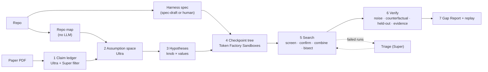

# GapFinder architecture

GapFinder takes a paper and its code and asks why a reproduction's numbers differ from the
paper's. It reads the paper, lists the experimental conditions the results could depend on,
then tests those conditions as controlled experiments in forked sandboxes. A claim is attributed
to a condition only after that condition survives verification. GapFinder never edits the paper's
algorithm code.

## Pipeline, stage by stage

| Stage | What it does | Code |
|---|---|---|
| **1. Claim ledger** | Nemotron 3 Ultra extracts every result the paper claims; a Super pass drops non-results. Every quote must string-match the PDF text, and page numbers are corrected, or the claim is dropped. | `ledger/claims.py`, `ledger/grounding.py`, `ingest/pdf.py` |
| **Repo map** | Plain code, no LLM: argparse, gflags, CMake, Make, configs and env flags, each with its default and `file:line`. | `ingest/repo_map.py` |
| **2. Assumption space** | Ultra reads the setup section, the repo map and the relevant files. It lists the conditions the results could depend on, each with a paper quote or code location (checked), the paper's stated value, candidate values and a prior. Status ("stated, code differs" and so on) is computed in code, not by the model. | `ledger/assumptions.py` |
| **Harness spec** | One YAML per artifact: base image, `build`, `load` and `run` commands, knobs with their layer (build, dataset, config, workload, environment), defaults and cost limits, the output format, and the paths a branch may write. `gapfinder spec-draft` drafts it from the repo and smoke-tests it in a sandbox; a human approves it. | `sandbox/spec.py`, `spec_draft.py` |
| **3. Hypotheses** | Assumption × spec knob × candidate values. The paper's own values come first. Values over a knob's cost limit are reported as "not testable", not run. A ledger-free mode uses every spec knob instead (the random-order ablation). | `search/engine.py` (`hypotheses`), `search/hypotheses.py` |
| **4. Checkpoint tree** | Build once, load once, checkpoint, then fork every branch from the deepest valid checkpoint. A config change forks the loaded state, a dataset change reloads from the build, a build flag rebuilds. Checkpoint IDs are content-addressed, so identical setups share an ID. That also lets GapFinder check whether a setup is reproducible (`--noise-setups`). | `sandbox/runner.py`, `sandbox/tree.py`, `sandbox/backend.py` |
| **5. Search** | Calibrate noise first: repeats of the default config, optionally on independent setups. Then: screen one change per branch; confirm survivors with repeats; combine the best and the highest-prior knobs in pairs; bisect combinations to a minimal set (delta debugging). Failed branches go to Super for triage, which may propose one valid value. | `search/engine.py`, `search/bisect.py`, `search/triage.py`, `sandbox/noise.py` |
| **6. Verify** | A candidate must close the gap within the noise band; pass a bootstrap test against the default; make the gap return when each knob is reverted; leave held-out claims no worse; and have evidence that the authors used the value (paper, code, then the web via Tavily). | `search/verify.py`, `search/evidence.py` |
| **7. Gap Report** | One card per claim: what the paper reported, what was measured, which branch changed it, why we believe it, and what remains unknown. It also gives effect sizes, a provenance block (code, model and prompt hashes, spec hash, cost) and a copy-paste command to replay the branch. Output is Markdown and JSON. | `report/gap_report.py`, `report/provenance.py`, `report/missing_sentence.py` |

**Labels:**

| Label | Meaning |
|---|---|
| Explained | all checks pass |
| Paper-artifact inconsistency | the paper states a value and the code defaults to another |
| Partially explained | closes at least half of the gap |
| Fits but unsupported | closes the gap, but there's no evidence the authors used the value |
| Unexplained | nothing tested passes |
| Inconclusive | inside the noise, but the noise is too wide to decide |
| Reproduced | inside a tight noise band |

When the budget runs out, nothing unconfirmed is labelled.

## Frameworks and services

| Layer | Technology |
|---|---|
| Language and data model | Python 3.11; frozen pydantic models for Claim, Assumption, Branch, Attribution (`ledger/schemas.py`) |
| Models | NVIDIA Nemotron 3 on Nebius Token Factory, through the OpenAI-compatible API: **Ultra** for the ledger and assumptions, **Super** for the result filter, triage, spec-draft (Ultra after two failed drafts), the missing-sentence draft and the baseline agent, **Nano** as a fallback log parser |
| Model router | Splits the reasoning trace from the answer, repairs JSON, retries once on an empty answer, caches every response, meters tokens, and checks a hard spend cap before every call (`models/router.py`, `models/budget.py`) |
| Execution | Token Factory Sandboxes through `contree-sdk`; a local directory-snapshot backend with the same interface, for tests and free runs |
| PDF | PyMuPDF (page text, figure crops) |
| Web evidence | Tavily search, cached |
| Server and UI | FastAPI with server-sent events for replay; React + Vite single-page app; a static build for GitHub Pages (`scripts/export_static.py`) |
| Baseline | mini-swe-agent on Nemotron 3 Super, given the same sandbox, paper text, repo map and budget (`eval/baseline/`) |
| Tests | pytest (unit, local-backend integration, the toy planted-cause suite), Playwright for the browser path |

## Cross-cutting design

- **Grounding before trust.** Every quote and `file:line` the model cites is checked, and a mismatch is dropped, never repaired.
- **The model proposes, experiments decide.** LLMs read and rank; only measured runs move a verdict.
- **Noise is explicit.** Bands come from repeats; noisy metrics get more repeats; effects need a bootstrap interval that excludes zero; setups that aren't reproducible widen the band.
- **Scope rule.** A diff guard rejects any branch that writes outside the spec's allowed paths, so only conditions change.
- **Money safety.** Every paid call, model or sandbox, is recorded in a spend ledger with hard caps. Every sandbox command runs under `ulimit -t`.
- **Everything replays.** Each run writes an append-only JSONL event log (`sandbox/events.py`). The UI replays it, and searches can resume from it without re-running anything.

## Evaluation harness

| Piece | What it is |
|---|---|
| GapBench-mini | Two small artifacts (`rlbench`, `mlbench`) with planted causes. Dev tasks for tuning; hidden test tasks from a sealed random generator whose seed is created after a freeze tag. Arms: GapFinder, no-verification, evidence-off, random order, and the baseline. |
| Scoring | `eval/gapbench/score.py`, with categories, Wilson intervals and a trust matrix (protocol in `eval/gapbench/PROTOCOL.md`) |
| External cases | RusKey (`papers/ruskey/`) and MC Dropout (`eval/external/mc-dropout/`) |
| Free entry point | `scripts/try_it.py` runs a full investigation from committed model answers, with no keys |
